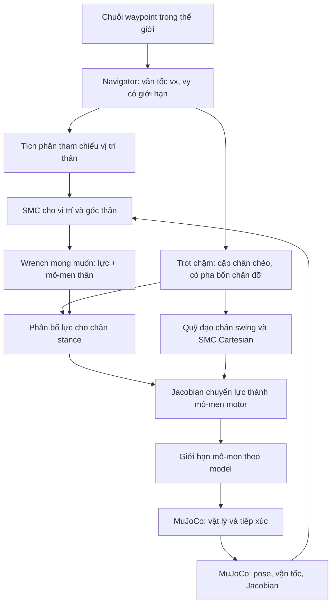

# Navigation Go2 bằng thư viện SMC C++

## 1. Bản này làm được gì?

Go2 tự đứng, đi chậm qua các điểm `(x, y)` trên sàn phẳng và dừng. Vị trí, vận tốc và góc thân lấy trực tiếp từ MuJoCo. Bộ điều khiển phát mô-men vào 12 motor, MuJoCo tính chuyển động và tiếp xúc. Giữ nguyên [model Menagerie](../models/quadruped/go2.xml), không gắn bánh xe, không cố định thân và không dùng lực ngoài để đỡ/kéo robot.

Tuyến mặc định: `(0, 0)` → `(0.6, 0)` → `(0.6, 0.4)` m. Robot giữ yaw ban đầu nên có thể đi ngang ở đoạn thứ hai. Đây là bám waypoint với state hoàn hảo trên sàn trống; chưa bao gồm định vị bằng cảm biến, SLAM, lập đường tránh vật cản, mục tiêu yaw, địa hình gồ ghề hoặc chống ngã ở nhiễu lớn.

## 2. Các lớp điều khiển



Navigator chỉ tạo vận tốc tham chiếu và quyết định waypoint tiếp theo. **SMC nằm ở vòng giữ thân và vòng bám chân swing**; đây là hệ kết hợp navigator, SMC, lịch bước và phân bổ lực. Đường đi không được tạo bằng cách ghi lại `qpos` khi mô phỏng đang chạy.

| CMake target | API | Nhiệm vụ / phụ thuộc |
| --- | --- | --- |
| `quadruped::smc` | [ReachingLaw](../libraries/smc/include/smc/reaching_law.hpp) | Luật SMC bậc hai; thư viện chuẩn C++ |
| `quadruped::navigation` | [WaypointNavigator](../include/navigation/waypoint_navigator.hpp) | Bám chuỗi điểm; thư viện chuẩn C++ |
| `quadruped::locomotion` | [ForceAllocator](../include/locomotion/force_allocator.hpp) | Phân bổ lực tiếp đất; Eigen |
| `quadruped::go2_control` | [Go2Controller, Go2Config](../include/simulation/go2_controller.hpp) | Đọc trạng thái, lịch chân, SMC và motor; MuJoCo + ba thư viện trên |

`JointSmc` tại [joint_smc.hpp](../libraries/smc/include/smc/joint_smc.hpp) là API mô-men một khớp được giữ lại nhưng không nằm trên đường điều khiển navigation hiện tại. `ReachingLaw` là luật đang được gọi ở mỗi bước.

## 3. Công thức SMC đang thực thi

Với một trục vị trí hoặc góc:

$$e=x-x_r,\qquad \dot e=\dot x-\dot x_r,\qquad s=\dot e+\lambda e.$$

Luật gia tốc ảo:

$$a_c=a_r-\lambda\dot e-k s-K\,\mathrm{sat}(s/\phi).$$

`sat(z)` giới hạn trong `[-1, 1]`. Kết quả `a_c` được giới hạn theo `acceleration_limit`. Các hạng có ý nghĩa:

- `λ > 0`: quyết định quan hệ giữa sai số vị trí và vận tốc trên mặt trượt.
- `k ≥ 0`: thành phần tiếp cận tuyến tính, giúp tắt dao động.
- `K ≥ 0`: cường độ thành phần chuyển mạch để chống sai số mô hình/nhiễu.
- `φ > 0`: bề dày lớp biên. Tăng φ làm chuyển mạch mềm hơn, đổi lại có thể tăng sai số dư.
- `a_r`: gia tốc feedforward nếu bên gọi biết. Adapter hiện dùng 0; vận tốc tham chiếu navigation được ramp chậm để giảm biến động.

Trong kênh bậc hai lý tưởng `ẍ=a_c` và khi chưa chạm giới hạn:

$$\dot s=-k s-K\,\mathrm{sat}(s/\phi).$$

Với `V=s²/2`, ta có `V̇=-k s²-K s sat(s/φ) ≤ 0`. Đây là điều kiện tiếp cận cho **kênh lý tưởng**, được kiểm tra bằng unit test. Trên robot thật trong mô phỏng, khối lượng/quán tính xấp xỉ, đổi tiếp xúc, giới hạn ma sát và bão hòa mô-men làm kênh khác hệ lý tưởng. Không suy ra chứng minh ổn định toàn thân từ công thức này. Nếu thêm nhiễu hiệu dụng `d`, xuất hiện hạng `s d`; chọn K cần biết chặn nhiễu, còn trong lớp biên thường chỉ kỳ vọng sai số bị chặn.

Ví dụ sử dụng độc lập:

```cpp
#include "smc/reaching_law.hpp"

smc::ReachingLaw smc_axis({5.0, 4.0, 2.0, 0.1, 20.0});
// Thứ tự: lambda, linear_gain, switching_gain, boundary_layer, acceleration_limit
double acceleration = smc_axis.acceleration(x - x_ref, vx - vx_ref, ax_ref);
// Cần ánh xạ acceleration qua động lực học của hệ trước khi gửi đến actuator.
```

[Ví dụ đầy đủ](../examples/smc_channel.cpp) điều khiển một hệ khối lượng đơn vị. Đây là ví dụ API, không phải mô hình Go2.

## 4. Từ gia tốc thân đến mô-men motor

### Vòng giữ thân

Navigator tạo vận tốc thế giới tối đa `0.12 m/s`, gia tốc lệnh tối đa `0.15 m/s²`. Vị trí tham chiếu được tích phân từ lệnh; sai lệch tham chiếu được chặn ±0.12 m so với robot để tránh tích lũy quá xa. Thân nâng từ `home` 0.27 m đến 0.31 m trong 1,5 s đầu; robot chưa bước trong khoảng này.

SMC tuyến tính tạo gia tốc x/y/z. SMC góc giữ thân thẳng và bám yaw tham chiếu: cố định khi Stand/waypoint demo, hoặc tích phân yaw rate khi nhận cmd_vel từ ROS. Cả sai số tư thế `e_R = Log(R R_refᵀ)` (rotation vector) và vận tốc góc đều trong hệ thế giới. Không ghép Euler roll/pitch của thân với omega thế giới; lỗi ghép trục đó gây nghiêng khi vừa đi vừa quay heading 90°. Các góc Euler trong telemetry chỉ dùng hiển thị và phát hiện ngã.

Lực/mô-men mong muốn:

$$F_d=m(a_c-g),\qquad M_d\approx I_{approx}\alpha_c.$$

`m` lấy từ tổng khối lượng cây robot; `I_body=diag(0.25, 0.8, 0.9) kg·m²` là xấp xỉ quán tính centroidal. Mô-men hiện tính bằng `I_world α + ω × (I_world ω)`, với `I_world = R I_body Rᵀ`, để giữ đúng hệ tọa độ sau khi đổi heading. Đây vẫn là mô hình rút gọn, chưa triệt tiêu đầy đủ động lực học toàn thân. Mô-men được tính quanh COM toàn robot, còn tham chiếu vị trí theo gốc thân; đây cũng là một xấp xỉ của demo.

### Phân bổ lực chân stance

Mỗi lực `f_i` là **lực mặt đất tác dụng lên robot**, trong hệ thế giới. Với `r_i` từ COM đến tâm bàn chân:

$$A f=\begin{bmatrix}\sum_i f_i\\\sum_i r_i\times f_i\end{bmatrix}.$$

Giải gần đúng bài toán bình phương tối thiểu có regularization:

$$\min_f\ \tfrac12\|W(Af-w_d)\|^2+\tfrac{0.02}{2}\|f\|^2,$$

với `W=diag(1,1,1,5,5,3)`. Ràng buộc từng chân stance: `0 ≤ fz ≤ 160 N`, `|fx| ≤ 0.5 fz`, `|fy| ≤ 0.5 fz`. Hình chóp này nằm trong nón ma sát với μ=0.8 của bàn chân gốc. Chân swing có lực đỡ bằng 0.

[ForceAllocator](../src/locomotion/force_allocator.cpp) dùng 100 bước projected gradient và phép chiếu Euclidean lên miền lực. Đây là nghiệm lặp hữu hạn, chưa phải QP solver có chứng nhận hội tụ/KKT ở mỗi bước. Log `wrench_residual` là norm dư sau trọng số W. Vì force và moment có đơn vị khác nhau, residual là chỉ số tối ưu có trọng số, không nên diễn giải tất cả thành Newton.

Lịch stance/swing là lịch dự kiến theo pha. Tiếp xúc thực được đọc và log để kiểm chứng nhưng chưa dùng làm điều kiện đổi pha hay tái phân bổ lực; vì vậy bản này chỉ được kiểm tra trên sàn phẳng.

### Chân swing và mô-men

Trot chậm dùng hai cặp chéo FL–RR và FR–RL lệch pha nửa chu kỳ. Chu kỳ `0.65 s`, stance fraction `0.65`; có đoạn bốn chân cùng đỡ. Khi hết lệnh vận tốc, không bắt đầu swing mới và cho chân đang swing hoàn thành rồi đứng giữ vị trí.

Điểm đặt chân được ước lượng từ vị trí thân, offset bàn chân lúc reset, vận tốc lệnh trong thời gian còn lại và phản hồi vận tốc nhỏ. Quỹ đạo ngang dùng đa thức bậc năm `10u³−15u⁴+6u⁵`; phương thẳng đứng cộng `h sin²(πu)` với `h=0.065 m`. Tâm chân khi đáp đặt ở z=0.022 m, theo bán kính bàn chân của model.

SMC Cartesian bám vị trí/vận tốc chân swing. Adapter chuyển gia tốc ảo thành lực với khối lượng ảo 1 kg, chưa dùng ma trận quán tính không gian tác vụ. Sai số gia tốc quỹ đạo không được feedforward ở bản này. Vòng điều khiển cổ điển này được tuning và kiểm thử thực nghiệm trên model hiện tại.

Lực điều khiển tại chân là `Ffoot=-f_i` khi stance, và `Ffoot=1 kg · a_swing` khi swing. Mô-men khớp:

$$\tau_j=J_j^T F_{foot}+qfrc\_bias_j-qfrc\_passive_j.$$

Dấu âm ở stance xuất phát từ `f_i` là lực đất đẩy lên robot; motor phải tác dụng lực ngược vào chân. `qfrc_bias` cung cấp trọng lực/Coriolis; `qfrc_passive` bù lực thụ động. Đây là ánh xạ lực có bù bias, không phải nghịch động lực học toàn thân chính xác. Các ràng buộc friction loss trong solver chưa được triệt tiêu.

Cuối cùng clamp theo giới hạn của motor từ model: hip/thigh ±23.7 N·m; calf ±45.43 N·m. Bài toán lực chưa xét bất đẳng thức mô-men motor; bước clamp có thể làm wrench thực khác wrench yêu cầu. Không đặt giới hạn ±30 chung cho cả 12 motor. Adapter tra theo tên và địa chỉ khớp/actuator, kiểm tra motor có gear=1.

## 5. Vòng mô phỏng và sử dụng adapter

```cpp
simulation::Go2Config config;
config.navigation.max_speed = 0.12;
config.body_height = 0.31;
simulation::Go2Controller controller(model, {{0.6, 0.0}, {0.6, 0.4}}, config);

mj_resetDataKeyframe(model, data, 0);
mju_zero(data->ctrl, model->nu);
mj_forward(model, data);
controller.reset(data);

// Lặp ở timestep 0.002 s của model:
mj_step1(model, data);  // Cập nhật kinematics, velocity, Jacobian, bias.
controller.update(data, simulation::Mode::Navigate);
mj_step2(model, data);  // Tích phân vật lý bằng mô-men vừa tính.
```

Trình tự này dựa trên [API mô phỏng của MuJoCo](https://mujoco.readthedocs.io/en/stable/APIreference/APIfunctions.html#mj-step1). Model Go2 hiện dùng Euler mặc định; không đổi sang RK4 với vòng `step1/step2` này. Jacobian bàn chân được lấy bằng `mj_jacGeom`; xem [tài liệu Jacobian](https://mujoco.readthedocs.io/en/stable/APIreference/APIfunctions.html#mj-jacgeom). Ý nghĩa phương trình động lực học và lực ràng buộc có trong [MuJoCo computation](https://mujoco.readthedocs.io/en/stable/computation/index.html).

Controller chỉ ghi `ctrl`. Nếu thân thấp hơn 0.15 m hoặc |roll|/|pitch| vượt 0.85 rad sau 0.3 s, trạng thái FALLEN được giữ và mô-men về 0 cho đến reset. Đây là phát hiện ngã, không phải động tác tự đứng dậy. Phím R hoặc đổi mode bằng 0/1/2 reset cả vật lý và bộ điều khiển để tránh lệnh cũ còn sót.

## 6. Chạy và đo

Từ thư mục workspace:

```bash
cmake --preset dev
cmake --build --preset dev
ctest --preset dev
./build/quadruped_viewer --controller navigate --autostart
```

Tự chọn đích và lưu log:

```bash
mkdir -p logs
./build/quadruped_viewer --headless --controller navigate --duration 30 \
  --waypoint 0.6 0 --waypoint 0.6 0.4 --check --log logs/navigation.csv
```

Trong headless, `--check` thất bại nếu ngã, có cảnh báo MuJoCo, trạng thái không hữu hạn, thời gian không tiến đủ, chưa hết tuyến, sai số đích cuối >0.10 m hoặc vận tốc cuối >0.08 m/s. Posture cuối phải cao ≥0.24 m, |roll|/|pitch| ≤0.2 rad. CTest vật lý kiểm tra chặt hơn cho tuyến cố định.

Có thể kiểm tra cửa sổ đồ họa với `./build/quadruped_viewer --autostart --duration 30 --check`; viewer đóng sau 30 giây mô phỏng và kiểm tra tiêu chí posture/đích/dừng, báo lỗi nếu ngã. Đã chạy thực tế trên RTX 4050: sai số cuối 0.02813 m, cùng kết quả headless. Viewer kiểm tra mode sau khởi tạo đồ họa; đổi mode bằng bàn phím được ghi ra terminal và reset robot.

Trong CSV, `planned_stance_feet` là số chân được giao đỡ, `contact_feet` là số chân có tiếp xúc thật với sàn. `FL_foot_z`… là chiều cao tâm chân. `tau_*` là mô-men đang gửi đến motor, không phải cảm biến mô-men. `complete` là trạng thái đã hết tuyến; trường `distance` về 0 lúc hết tuyến, nên để tính sai số cuối phải dùng `(x, y)` trừ waypoint cuối.

`controller_mode` ghi mode thực tế: 0=passive, 1=stand, 2=navigate, giúp phân biệt mô-men bằng 0 do lựa chọn mode hay do robot đã ngã.

## 7. Kiểm chứng đã có

Trên MuJoCo 3.3.5, model Menagerie không sửa đổi, dt=0.002 s, preset RelWithDebInfo:

| Bài thử tự động | Tiêu chí và kết quả quan sát |
| --- | --- |
| `smc_control_law` | Dấu chuyển mạch, lớp biên, giới hạn mô-men, input sai |
| `control_libraries` | Điều kiện tiếp cận và hội tụ hệ bậc hai; waypoint liên tiếp; giới hạn vận tốc/gia tốc; lực trong chóp ma sát, unilateral và lực swing bằng 0 |
| `model_simulation` | 2.000 bước passive; trạng thái hữu hạn và không có cảnh báo |
| `go2_physical_control`: đứng có nhiễu | Roll ban đầu 0.05 rad, pitch −0.035 rad, vận tốc (0.04, −0.02) m/s; lực đẩy (12,8,0) N trong 0.15 s ở t≈5 s. Sau 12 s: z≈0.3097 m, lệch ngang ≈0.00045 m, tốc độ ≈0.00016 m/s |
| `go2_physical_control`: hai đích | `(0.45,0)` → `(0.45,0.3)` trong 25 s; cuối ≈(0.4435,0.2663), sai số ≈3.43 cm, max tilt≈0.0962 rad, tâm chân cao nhất≈0.086 m. Có 1.947 bước ghi nhận vừa có swing dự kiến vừa có chân rời tiếp xúc |
| Demo mặc định 30 s | `(0.6,0)` → `(0.6,0.4)`; cuối ≈(0.5956,0.3722), sai số ≈2.81 cm, tốc độ cuối ≈0.000019 m/s; không ngã, peak mô-men ≈30.43 N·m ở motor calf (giới hạn calf 45.43 N·m) |

Bài navigation kiểm tra không có `qfrc_applied` hoặc `xfrc_applied`, mô-men đúng giới hạn, trạng thái hữu hạn, không có cảnh báo, tư thế và vận tốc cuối. Bài đứng chỉ thêm lực đẩy có khai báo để kiểm tra phản hồi; không có lực đỡ ngoài. Sau các bài thử còn kiểm tra reset xóa trạng thái route/fall.

Các số trên là phép thử hữu hạn, không xác nhận khả năng hoạt động trên robot thật hay mọi điều kiện ban đầu. Hãy chạy lại CTest và xem CSV sau mỗi lần sửa thông số.

## 8. Chỉnh tham số có kiểm soát

`Go2Config` nằm trong [header controller](../include/simulation/go2_controller.hpp). Nhóm tham số SMC đang dùng:

| Kênh | λ | k | K | φ | Giới hạn gia tốc |
| --- | ---: | ---: | ---: | ---: | ---: |
| Thân x/y | 4 | 4 | 0.8 | 0.12 | 3 m/s² |
| Thân z | 12 | 8 | 1.5 | 0.12 | 8 m/s² |
| Góc thân | 10 | 6 | 2 | 0.2 | 60 rad/s² |
| Chân swing | 15 | 10 | 3 | 0.2 | 120 m/s² |

Các trục có đơn vị khác nhau nên φ không phải thông số không thứ nguyên chung. Cách tuning thực tế:

1. Chạy chế độ stand trước, xác nhận chiều cao, roll/pitch và mô-men.
2. Chạy một đích phía trước với tốc độ nhỏ; kiểm tra chân có nhấc, robot dừng và còn margin mô-men.
3. Thêm đích đi ngang/lùi, quan sát tiếp xúc thực và wrench residual.
4. Nếu rung: thử tăng φ hoặc giảm K, rồi kiểm tra lại sai số. Tăng K quá lớn dễ bão hòa motor.
5. Nếu thay model, khối lượng, ma sát hoặc gait, cần tuning lại và bổ sung bài thử tương ứng.

Để phát triển thành navigation đầy đủ: bổ sung ước lượng trạng thái từ cảm biến, lập đường có bản đồ/vật cản, contact-aware gait, phân bổ lực có giới hạn mô-men và nghịch động lực học toàn thân. Giữ thư viện SMC riêng để có thể so sánh cùng một giao diện với bộ điều khiển khác.
