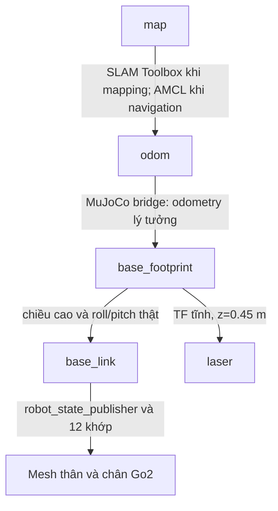

# Go2: MuJoCo → SLAM → bản đồ → AMCL/Nav2 → SMC → RViz

## Phạm vi

Project dùng **ROS 2 Humble / Ubuntu 22.04**, giữ nguyên robot Unitree Go2 từ Menagerie và thư viện SMC C++ hiện có. Phòng mới **10 × 8 m**, tường tại x=−4/6, y=−4/4; diện tích thông thủy 9.84 × 7.84 m, gần gấp 5 lần phòng cũ. Có hai cột, hai vách ngăn và một khối hộp, bố trí để còn lối đi rộng. Đường thẳng từ `(0,0)` đến `(4.6,0)` bị vách chắn. MuJoCo tính vật lý chân–sàn; robot chỉ nhận mô-men motor từ SMC.

SLAM Toolbox tạo occupancy grid **từ LaserScan ray-casting**. Sau khi lưu map, có thể dừng mapping, khởi động lại mô phỏng và dùng **AMCL + Nav2 trên chính map đó**. RViz hiển thị model Go2 với mesh Unitree và 12 khớp đồng bộ với MuJoCo, laser, map, costmap và đường Nav2.

```mermaid
flowchart LR
  M[MuJoCo: Go2 và căn phòng] --> S[LaserScan /scan]
  M --> O[Odometry /odom và TF]
  S --> SL[SLAM Toolbox]
  O --> SL
  SL --> MAP[Map đã quét: YAML + PGM]
  MAP --> AMCL[AMCL: định vị trên map]
  S --> AMCL
  AMCL --> N[Nav2: A* và costmap]
  MAP --> N
  G[RViz: Nav2 Goal] --> N
  N --> P[Plugin SMC bám đường]
  P --> V[/cmd_vel]
  V --> C[SMC giữ thân, lực chân và motor]
  C --> M
  M --> R[RViz: RobotModel và JointState]
```

Đây là demo SLAM/navigation **2D trên sàn phẳng**, không phải mô hình cảm biến thực đã được hiệu chuẩn. Odometry là odometry lý tưởng lấy từ mô phỏng; LiDAR là cảm biến ảo ổn định theo trọng lực ở z=0.45 m, 720 tia/360°, 10 Hz, phạm vi 0.08–12 m, không noise/motion distortion. SLAM vẫn xử lý scan để tạo map và ước lượng `map → odom`; không xuất map từ hình học XML hoặc gán sẵn TF `map → odom`.

## Cài đặt và build

Máy hiện tại đã có ROS 2 Humble, CMake, Eigen, GLFW, OpenGL và MuJoCo SDK. SLAM Toolbox/Nav2 được tải dưới dạng gói Ubuntu/ROS và giải nén vào [overlay dependency](../third_party/ros_deps/), không cần quyền sudo. Các thư viện dùng đúng dependency của gói ROS đã tải. Overlay là cache cục bộ, được bỏ qua bởi Git.

Nếu checkout mới trên máy Humble tương thích:

```bash
bash scripts/install_ros_deps.bash
bash scripts/build_ros.bash
```

[install_ros_deps.bash](../scripts/install_ros_deps.bash) dùng `apt-get -s`, `apt-get download` và `dpkg-deb -x`; cần cấu hình apt repository ROS 2 sẵn. Nó tải phần dependency đang thiếu và sửa các đường dẫn CMake tuyệt đối trong export cần relocation. Có thể dùng gói hệ thống `ros-humble-navigation2`, `ros-humble-nav2-bringup`, `ros-humble-slam-toolbox` thay overlay nếu máy đã cài đủ.

[build_ros.bash](../scripts/build_ros.bash) build package C++ bằng colcon trong thư mục riêng `ros2_build`, `ros2_install`, `ros2_logs`; không đè build CMake cũ. Source môi trường trong **mỗi terminal** cần gọi ROS:

```bash
source scripts/ros_env.bash
```

Script chọn ROS_DOMAIN_ID mặc định **42**, localhost-only, thêm các thư viện overlay/MuJoCo và ép NVIDIA PRIME cho MuJoCo/RViz. Nếu đặt domain khác, dùng cùng domain cho mọi terminal. Nó xóa các biến Snap kế thừa từ VS Code vì SLAM Toolbox dùng chúng để viết lại đường dẫn lưu pose graph.

## Quy trình sử dụng

### 1. Quét map và xem RViz

```bash
bash scripts/run_mapping.bash
```

Mở MuJoCo và RViz; robot tự đi một vòng an toàn trong phòng. Khi terminal báo **Mapping loop complete**, robot đứng lại. Đây là route thu thập dữ liệu đã định trước trong phòng demo; chưa có thuật toán frontier exploration. LiDAR và SLAM chạy trong suốt quá trình, map trên RViz được cập nhật mỗi giây mô phỏng.

Route quét phòng lớn nằm trong [mapping.yaml](../ros2/go2_smc_ros/config/mapping.yaml), gồm hai mảng `route_x`, `route_y` và `cruise_speed`. Toàn vòng dài khoảng 35 m, cần khoảng 6 phút mô phỏng ở tốc độ 0.10 m/s; có thể dùng `headless:=true rviz:=false realtime_factor:=4.0` để quét nhanh hơn. Các điểm quét tránh khối/vách trong world mới.

Muốn tự điều khiển thay route tự động:

```bash
bash scripts/run_mapping.bash explore:=false
# Terminal khác:
source scripts/ros_env.bash
ros2 run teleop_twist_keyboard teleop_twist_keyboard --ros-args -p use_sim_time:=true
```

`cmd_vel.linear.x/y` là vận tốc thân, `angular.z` là tốc độ yaw. SMC giới hạn tốc độ ngang ≤0.12 m/s và yaw rate ≤0.25 rad/s. Nav2 ưu tiên đi trước theo heading của đoạn đường, giảm tốc/quay tại chỗ ở góc rẽ lớn và căn yaw cuối; vận tốc quay mặc định của plugin là 0.18 rad/s. Dùng teleop với lệnh nhỏ; giới hạn của SMC không thay thế tránh vật cản khi teleop.

### 2. Lưu map trong lúc mapping còn chạy

Terminal khác:

```bash
bash scripts/save_map.bash
```

Kết quả trong [maps](../maps/):

- `go2_slam.yaml`: metadata cho map server/Nav2.
- `go2_slam.pgm`: occupancy grid do SLAM tạo, độ phân giải 0.05 m.
- `go2_slam.posegraph` và `go2_slam.data`: pose graph/các scan để lưu trạng thái SLAM.

PGM/YAML dùng cho localization/navigation; pose graph dùng để tiếp tục/xử lý lại SLAM, hai loại file có vai trò khác nhau. Tiện ích lưu map lấy `/map` từ SLAM Toolbox; không vẽ map thủ công. Hãy giữ mapping chạy đến khi lưu xong, sau đó Ctrl+C terminal mapping.

### 3. Navigation trên map vừa lưu

```bash
bash scripts/run_navigation.bash
```

Mô phỏng khởi động lại ở vị trí đầu `(0,0)`. Map server đọc `maps/go2_slam.yaml`, AMCL định vị từ scan/odom với pose khởi tạo `(0,0,0)`. Chỉ AMCL xuất `map → odom` trong mode này; SLAM Toolbox không chạy đồng thời để tránh hai publisher trùng TF.

Đợi **Managed nodes are active**, chọn **Nav2 Goal** trên thanh công cụ RViz. Nhấn tại vị trí đích, kéo mũi tên theo hướng robot cần nhìn khi đến và thả chuột. Mũi tên yaw được thực thi: robot quay theo đường đi, đến gần vị trí đích rồi quay căn hướng cuối. Tolerance vị trí là 0.12 m, tolerance yaw là 0.08 rad (khoảng 4.6°); không còn bỏ qua yaw như bản trước.

RViz dùng góc nhìn **TopDownOrtho**, tâm `(1,0)`, scale 60 pixel/m để thấy cả phòng. Lăn chuột để zoom, Shift + kéo chuột để dịch góc nhìn. Chọn đích trong vùng trống, cách vùng tường/vật cản đã inflation một khoảng; không chọn ô unknown hoặc trong vật cản. Các đích ví dụ: `(4.6,0)`, `(-2.5,2.5)`, `(0,0)`. Góc nhìn MuJoCo tự tính theo kích thước phòng.

Cũng có thể gửi mục tiêu bằng C++ client:

```bash
source scripts/ros_env.bash
ros2 run go2_smc_ros navigation_goal --ros-args -p use_sim_time:=true -p x:=4.6 -p y:=0.0
# Goal có hướng cuối 90°:
ros2 run go2_smc_ros navigation_goal --ros-args -p use_sim_time:=true -p x:=0.0 -p y:=1.0 -p yaw:=1.57079632679
```

Client chờ lifecycle Nav2 active, gửi action `NavigateToPose`, chờ kết quả và kiểm tra feedback đích, trạng thái ngã và tiếp xúc vật cản. Mục tiêu `(4.6,0)` nằm bên kia vách ngăn: global planner phải tìm đường vòng.

Không chạy hai launch Go2 cùng domain. Dừng mode cũ bằng Ctrl+C trước khi chuyển mapping/navigation; thời gian mô phỏng sẽ về 0 và các node liên quan cần được khởi động lại cùng mode.

Các script mapping/navigation/test dùng khóa `flock` theo workspace và ROS domain để chặn mở trùng. Nếu thấy “Go2 is already running”, dừng launch hiện tại bằng Ctrl+C trước khi chạy mode mới; không mở thêm `ros2 launch` thủ công song song vì có thể trộn hai nguồn `/clock`, scan và TF.

## Các frame và topic



| Topic | Nguồn / ý nghĩa |
| --- | --- |
| `/clock` | Thời gian MuJoCo, 100 Hz; thuật toán dùng `use_sim_time=true` |
| `/scan` | 720 ray trên hình học vật cản group 4 của MuJoCo |
| `/odom` | Pose 2D/vận tốc từ mô phỏng, 50 Hz |
| `/joint_states` | Góc/vận tốc 12 khớp thật trong MuJoCo, 50 Hz |
| `/robot_description` | URDF tạo từ MJCF và mesh Unitree; RViz hiển thị |
| `/map` | SLAM Toolbox khi mapping; map server khi navigation |
| `/plan` | Đường toàn cục Nav2 trong map |
| `/cmd_vel` | Lệnh vận tốc thân, đưa vào SMC; watchdog 0.5 giây mô phỏng |
| `/simulation/status` | Trạng thái thân, gồm phát hiện ngã |
| `/simulation/obstacle_contacts` | Số bước vật lý có tiếp xúc thật với tường/cột/vách; không tính sàn |
| `/mapping_route_complete` | Route mapping tự động đã kết thúc |

URDF chỉ dùng hiển thị, không thay thế động lực học MuJoCo. [description_generator.cpp](../ros2/go2_smc_ros/src/description_generator.cpp) đọc visual pose từ MJCF gốc, lấy tên/trục/giới hạn khớp từ model biên dịch và dùng chính OBJ của Menagerie. Tư thế thân ở RViz được TF cập nhật, các chân được robot_state_publisher cập nhật từ joint_states.

## SMC nằm ở đâu trong navigation mới?

1. Nav2 NavFn/A* lập đường trên occupancy grid/costmap có inflation và laser obstacles.
2. [SmcPathController](../ros2/go2_smc_ros/src/smc_path_controller.cpp), plugin `nav2_core::Controller` tự viết, chọn điểm phía trước theo chiều dài cung đường (mặc định 0.22 m). Dùng `smc::ReachingLaw` tạo gia tốc x/y và yaw; tích phân một chu kỳ 0.1 s với vận tốc đo, giới hạn 0.10 m/s và 0.18 rad/s. Sai số yaw được wrap về `[-π,π]`. Khi lệch hướng >0.55 rad, robot quay trước; khi lệch <0.20 rad, tiếp tục bước. Bước ngang chỉ dùng để chỉnh bám đường, giới hạn 0.025 m/s.
3. Trong phạm vi 0.10 m quanh đích, plugin giữ vị trí và căn quaternion yaw của goal. `PoseProgressChecker` tính cả chuyển động góc là tiến độ, vì quay tại chỗ không làm tăng quãng đường x/y. Plugin dự đoán footprint bán kính 0.36 m trong một giây trên local costmap, có cả yaw và quá trình hãm vận tốc; thử giảm lookahead nếu bị chặn. Global planner replan ở 1 Hz.
4. [Go2Controller](../src/simulation/go2_controller.cpp) nhận lệnh world velocity/yaw rate từ cmd_vel, tích phân yaw tham chiếu, đổi điểm đặt chân theo chuyển động quay, phân bổ lực và xuất mô-men 12 motor ở 500 Hz. Sai số tư thế dùng rotation vector `Log(R R_refᵀ)` trong hệ thế giới; quán tính xấp xỉ cũng quay sang hệ thế giới. Điều này tránh lỗi trộn Euler roll/pitch của thân với omega thế giới khi robot quay 90°.

Luật `a = -λ e_dot - k s - K sat(s/φ)`, `s=e_dot+λe` được dùng ở cả tầng bám đường và tầng thân/chân swing. Vì điểm lookahead thay đổi theo đường và không có feedforward quỹ đạo chính xác, đây là bộ bám đường thực nghiệm có gia tốc SMC, chưa phải chứng minh ổn định cho hệ liên tục toàn thân có vật cản. Xem thêm [thiết kế SMC nền](NAVIGATION_SMC.md).

Collision prediction có horizon hữu hạn, không phải bảo đảm an toàn trên mọi vận tốc/vật cản động. Behavior tree hiện hỗ trợ lập lại đường và bám đường; nếu không có đường/không tiến được thì action thất bại và robot dừng. Chưa có chuỗi recovery phức tạp, tự dựng người sau ngã hoặc navigation 3D.

## Kiểm chứng và log

Chạy bài thử toàn luồng, sau khi dừng launch đang chạy:

```bash
bash scripts/test_slam_nav.bash
```

Bài này thực sự chạy robot quét phòng lớn → lưu occupancy grid/pose graph → reset mô phỏng → khởi động AMCL/Nav2 → đi qua `(4.6,0)` → `(-2.5,2.5)` → `(0,0)`. Nó kiểm tra action thành công, feedback sai số cuối <0.25 m, có đường đi vòng ra ngoài |y|=0.4 m ở lượt đầu, không ngã và không có tiếp xúc vật cản trong log vật lý. Đây là kiểm thử cho đúng phòng demo và cấu hình hiện tại, không phải chứng nhận cho robot thật.

Các log ở `logs/slam_physics.csv`, `logs/nav2_physics.csv`, `logs/nav2_outbound.csv`, `logs/nav2_cross_room.csv`, `logs/nav2_return.csv` và kết quả action tương ứng. Thời gian tăng tốc dùng cho test: mapping 4×, navigation 3× khi headless; chạy GUI mặc định 1×. Không đặt `realtime_factor` cao khi dùng GUI vì renderer có thể giới hạn tốc độ thực.

Kết quả kiểm thử của map hiện tại được ghi trong [maps/README.md](../maps/README.md). Sai số là feedback cuối trước khi Nav2 kết thúc action, không phải tuyên bố độ chính xác định vị trên robot thật.

Kiểm thử heading không cần tạo lại map:

```bash
bash scripts/test_heading_nav.bash
bash scripts/test_heading_nav.bash --large-room
```

Bài ngắn gồm: quay tại chỗ tới +90°, đi tới `(0,1)` với yaw +90°, rẽ tới `(-1,1)` với yaw 180°, quay về `(0,0)` với yaw −90°. Bài dài dùng `(4.6,0,+90°)` → `(-2.5,2.5,180°)` → `(0,0,−90°)`. Client kiểm tra sai số vị trí <0.25 m và sai số yaw feedback <0.12 rad; Nav2 goal checker vẫn yêu cầu xy≤0.12 m, yaw≤0.08 rad tại thời điểm công nhận thành công. Log có `cmd_yaw_rate`, yaw thật của thân và sai số yaw từ feedback, kiểm tra lệnh quay hai chiều, không ngã/tiếp xúc vật cản.

CTest `go2_heading_control` kiểm tra quay trái/phải 90°, vừa đi vừa quay, đi theo trục thân đã quay và đi qua biên ±π. Không có lực ngoài hoặc chỉnh trực tiếp yaw trong lúc chạy; reset pose chỉ dùng khi bắt đầu kịch bản. Giới hạn mô-men được kiểm tra ở mọi bước vật lý.

Kết quả kiểm chứng heading ngày 2026-10-24: **5/5 CTest đạt**, 4 goal heading ngắn và 3 goal phòng lớn đạt, không ngã/va chạm. Với các goal phòng lớn có yaw đích +90°, 180°, −90°, sai số feedback cuối lần lượt:

| Goal `(x,y,yaw)` | Sai số vị trí | Sai số yaw tuyệt đối |
| --- | ---: | ---: |
| `(4.6,0,+90°)` | 0.0658 m | 0.0050 rad ≈ 0.28° |
| `(-2.5,2.5,180°)` | 0.0436 m | 0.0187 rad ≈ 1.07° |
| `(0,0,−90°)` | 0.0482 m | 0.0181 rad ≈ 1.04° |

Trên log vật lý của lượt phòng lớn, |roll| lớn nhất khoảng 0.0287 rad, |pitch| khoảng 0.0169 rad. Các số này là kết quả hữu hạn cho cấu hình hiện tại, không phải chứng minh ổn định trên mọi địa hình.

Core CMake cũ vẫn dùng được độc lập:

```bash
cmake --preset dev
cmake --build --preset dev
ctest --preset dev
```

Nguồn API: [Nav2 controller plugin](https://docs.nav2.org/plugin_tutorials/docs/writing_new_nav2controller_plugin.html), [SLAM Toolbox Humble](https://github.com/SteveMacenski/slam_toolbox/tree/humble), [MuJoCo ray casting](https://mujoco.readthedocs.io/en/stable/APIreference/APIfunctions.html#mj-ray). Các gói ROS/SLAM/Nav2 giữ giấy phép riêng trong dependency overlay; mesh Go2 giữ BSD-3-Clause của Menagerie.
